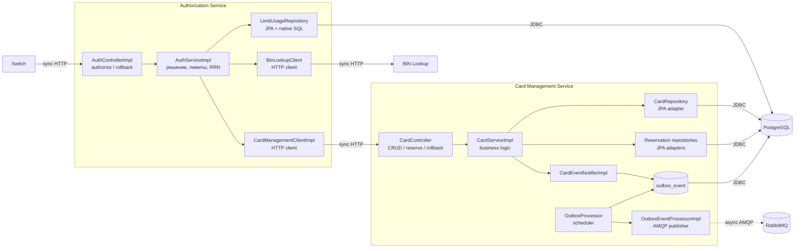

# A3. C4 Level 3 - Component

## Что было дополнено

Component-диаграммы в проекте не было. Я создала новую для Authorization и Card Management и показала controller -> service -> client/repository и outbox.

## Верификация по коду

### Authorization

- Запрос сначала приходит в [`AuthControllerImpl.java`](../../../services/authorization/src/main/java/com/processing/authorization/controller/AuthControllerImpl.java). В нём есть методы для обычной авторизации и для rollback. Сам контроллер ничего сложного не делает, а просто передаёт запрос дальше в `AuthServiceImpl`.
- В [`AuthServiceImpl.java`](../../../services/authorization/src/main/java/com/processing/authorization/services/AuthServiceImpl.java) уже находится основная логика. Здесь проверяется статус карты, срок действия, баланс и лимиты. Если всё нормально, вызывается резервирования.
- Для запросов в Card Management используется [`CardManagementClientImpl.java`](../../../services/authorization/src/main/java/com/processing/authorization/client/CardManagementClientImpl.java). Через него можно получить карту, зарезервировать деньги или сделать rollback.
- Для получения информации по BIN используется отдельный клиент [`BinLookupClient.java`](../../../services/authorization/src/main/java/com/processing/authorization/client/BinLookupClient.java).
- Лимиты проверяются через [`LimitUsageRepository.java`](../../../services/authorization/src/main/java/com/processing/authorization/repositories/LimitUsageRepository.java), который работает с базой данных.

То есть здесь получается такая цепочка:

`AuthControllerImpl -> AuthServiceImpl -> HTTP-клиенты или репозиторий`.

### Card Management

- Запросы по картам приходят в [`CardController.java`](../../../services/card-management/src/main/java/com/processing/cardmanagement/controllers/CardController.java). Здесь есть создание, получение, изменение и удаление карты, а также reserve и rollback.
- Дальше контроллер вызывает [`CardServiceImpl.java`](../../../services/card-management/src/main/java/com/processing/cardmanagement/services/CardServiceImpl.java). В нём находится логика работы с картами и резервированием денег.
- Для сохранения карт используется [`CardRepository.java`](../../../services/card-management/src/main/java/com/processing/cardmanagement/repositories/CardRepository.java).
- Для резервирований используются [`ReservationRepository.java`](../../../services/card-management/src/main/java/com/processing/cardmanagement/repositories/ReservationRepository.java) и [`ReservationRollbackRepository.java`](../../../services/card-management/src/main/java/com/processing/cardmanagement/repositories/ReservationRollbackRepository.java).

Здесь цепочка выглядит так:

`CardController -> CardServiceImpl -> repositories`.

### Outbox

- После операций с картой `CardServiceImpl` создаёт событие.
- [`CardEventNotifierImpl.java`](../../../services/card-management/src/main/java/com/processing/cardmanagement/events/CardEventNotifierImpl.java) сохраняет это событие в outbox. То есть событие не отправляется в RabbitMQ сразу.
- [`OutboxProcessor.java`](../../../services/card-management/src/main/java/com/processing/cardmanagement/services/OutboxProcessor.java) периодически проверяет, появились ли новые события.
- [`OutboxEventProcessorImpl.java`](../../../services/card-management/src/main/java/com/processing/cardmanagement/services/OutboxEventProcessorImpl.java) отправляет найденные события в RabbitMQ. Если отправка прошла успешно, событие отмечается как обработанное. Если произошла ошибка, выполняется повторная попытка, а после достижения лимита событие получает статус `FAILED`.

Поэтому outbox я показала на диаграмме отдельно, а его связь с RabbitMQ отметила как асинхронную.