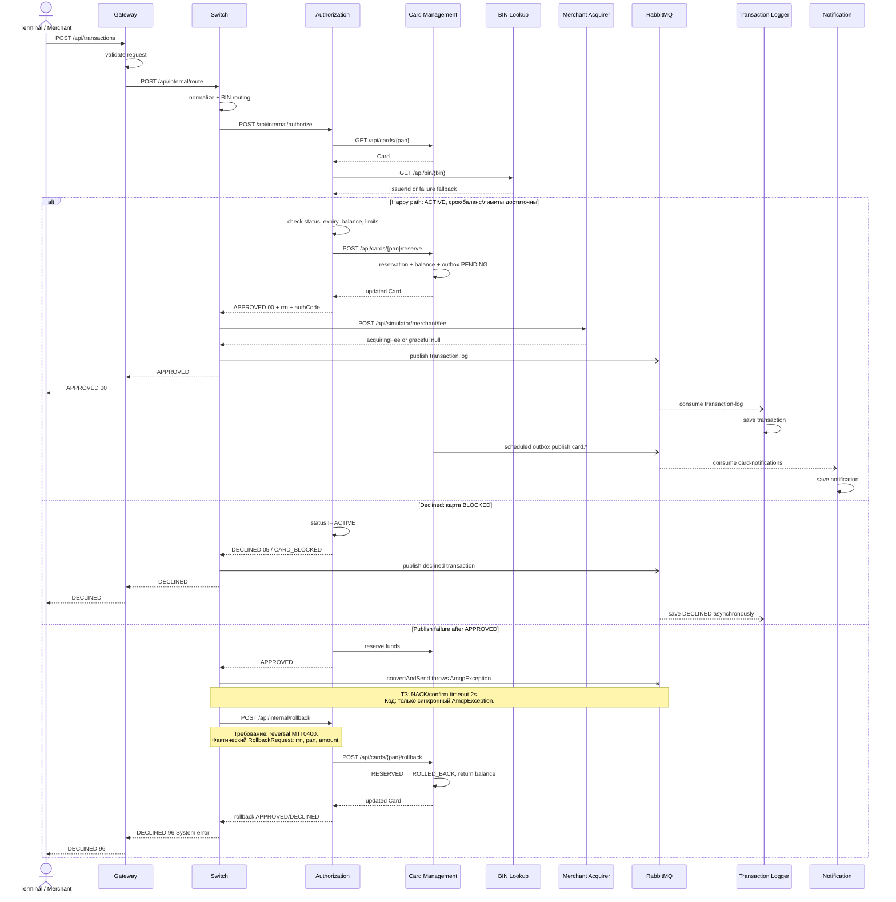

# A4. Sequence - путь транзакции

## Что было дополнено

В `docs/architecture.md` показан только успешный путь транзакции. Я добавила ещё два сценария, которые требуются в задании: отказ для заблокированной карты и отмену резервирования при ошибке отправки сообщения в RabbitMQ.

При проверке кода я обнаружила расхождение с заданием: Switch не ожидает подтверждение от RabbitMQ две секунды, а запрос на отмену не содержит `MTI 0400`. На диаграмме отдельно показано, как работает код и что при этом требовалось по заданию.

## Верификация по коду

### Основной порядок

- Общий порядок обработки транзакции посмотрела в [`RouteService.route()`](../../../services/switch/src/main/java/com/processing/service/RouteService.java). Switch определяет банк по BIN, отправляет запрос в Authorization, получает комиссию и передаёт транзакцию в Logger через RabbitMQ.
- Проверки карты находятся в [`AuthServiceImpl.authorize()`](../../../services/authorization/src/main/java/com/processing/authorization/services/AuthServiceImpl.java). Там проверяются статус карты, срок действия, баланс и лимиты.
- Если все проверки пройдены, Authorization вызывает резервирование денег. Оно реализовано в [`CardServiceImpl.reserve()`](../../../services/card-management/src/main/java/com/processing/cardmanagement/services/CardServiceImpl.java). После этого клиент получает ответ `APPROVED`.

### Заблокированная карта

- В `AuthServiceImpl.authorize()` отдельно проверяется статус карты.
- Если карта имеет статус `BLOCKED`, деньги не резервируются и транзакция отклоняется.
- Причина `CARD_BLOCKED` и код ответа `05` указаны в [`DeclineOutcome.java`](../../../services/authorization/src/main/java/com/processing/authorization/constants/DeclineOutcome.java).

### Rollback

- Switch отправляет данные транзакции в RabbitMQ через [`LoggerClient.log()`](../../../services/switch/src/main/java/com/processing/service/LoggerClient.java).
- Если отправка не удалась, но транзакция уже была одобрена, [`RouteService.route()`](../../../services/switch/src/main/java/com/processing/service/RouteService.java) запускает rollback.
- Запрос передаётся в Authorization через [`AuthorizationClient.rollback()`](../../../services/switch/src/main/java/com/processing/service/AuthorizationClient.java), а затем в Card Management.
- В [`CardServiceImpl.rollback()`](../../../services/card-management/src/main/java/com/processing/cardmanagement/services/CardServiceImpl.java) резервирование переводится в статус `ROLLED_BACK`, а деньги возвращаются на доступный баланс карты.
- После этого клиент получает `DECLINED` с кодом `96`.

### Что не совпало с требованиями

В [`tz/03-switch.md`](../../../tz/03-switch.md) написано, что Switch должен ждать подтверждение от RabbitMQ две секунды. Если подтверждения нет, нужно выполнить reversal с `MTI 0400`.

В настройках Switch подтверждения включены: [`application.yml`](../../../services/switch/src/main/resources/application.yml). Но в `LoggerClient.log()` нет ожидания подтверждения и таймера на две секунды. Метод только пытается отправить сообщение и обрабатывает ошибку `AmqpException`.

Также в [`RollbackRequest`](../../../services/common/src/main/java/com/processing/common/dto/authorization/RollbackRequest.java) нет поля `mti`. В запросе передаются только `rrn`, `pan` и `amount`.

Получается, что rollback в коде есть, но он работает не совсем так, как написано в требованиях.
