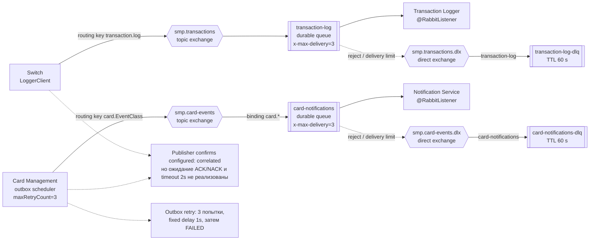

# A5. RabbitMQ-топология

## Что было дополнено

В [`docs/architecture.md`](../../architecture.md) RabbitMQ был описан текстом и таблицей. Я создала отдельную диаграмму с exchange, queue, routing key, DLX/DLQ и retry. Неподтверждённые параметры отмечены отдельно.

## Верификация по коду

### Путь транзакции

- Настройки для отправки транзакций находятся в [`switch/RabbitMQConfig.java`](../../../services/switch/src/main/java/com/processing/config/RabbitMQConfig.java) и [`transaction-logger/RabbitMQConfig.java`](../../../services/transaction-logger/src/main/java/com/processing/transactionlogger/config/RabbitMQConfig.java).
- Switch отправляет транзакцию в `smp.transactions`, оттуда она попадает в очередь `transaction-log`.
- Эту очередь слушает [`TransactionLogListener.java`](../../../services/transaction-logger/src/main/java/com/processing/transactionlogger/listener/TransactionLogListener.java). После получения сообщения Logger сохраняет транзакцию в базе.

Получается такой путь:

`Switch -> smp.transactions -> transaction-log -> Transaction Logger`.

### Путь событий карт

- Настройки находятся в [`card-management/RabbitMQConfig.java`](../../../services/card-management/src/main/java/com/processing/cardmanagement/config/RabbitMQConfig.java) и [`notification-service/RabbitMQConfig.java`](../../../services/notification-service/src/main/java/com/processing/notification/config/RabbitMQConfig.java).
- Card Management отправляет события в `smp.card-events`.
- После этого событие попадает в очередь `card-notifications`.
- Очередь слушает [`CardEventListener.java`](../../../services/notification-service/src/main/java/com/processing/notification/listener/CardEventListener.java). Он получает событие и сохраняет уведомление в базе.

Получается второй путь:

`Card Management -> smp.card-events -> card-notifications -> Notification Service`.

### Outbox и retry

- Событие Card Management сначала сохраняется в outbox.
- [`OutboxProcessor.java`](../../../services/card-management/src/main/java/com/processing/cardmanagement/services/OutboxProcessor.java) проверяет, появились ли новые события.
- [`OutboxEventProcessorImpl.java`](../../../services/card-management/src/main/java/com/processing/cardmanagement/services/OutboxEventProcessorImpl.java) отправляет их в RabbitMQ.
- В [`application.properties`](../../../services/card-management/src/main/resources/application.properties) указано три попытки с интервалом в одну секунду.
- Если событие отправилось, оно получает статус `PROCESSED`. Если три попытки закончились ошибкой - статус `FAILED`.

### DLQ

Для обоих путей есть отдельные очереди ошибок:

- `transaction-log-dlq` - для транзакций;
- `card-notifications-dlq` - для событий карт.

Для сообщений в этих очередях указан TTL 60 секунд. Также в настройках есть `x-max-delivery=3`.

При этом отдельной настройки повторной доставки для обработчиков я не нашла. Поэтому нужно проверить интеграционным тестом, действительно ли сообщение после трёх ошибок попадает в DLQ.

### Publisher confirms

В настройках publisher confirms включены, но в коде нет отдельного ожидания ACK/NACK. Получается, что настройка есть, но полная обработка подтверждения пока не реализована.
