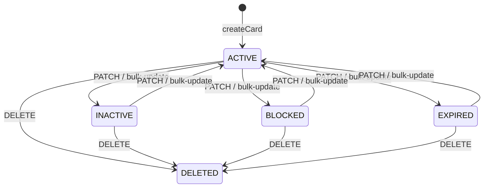
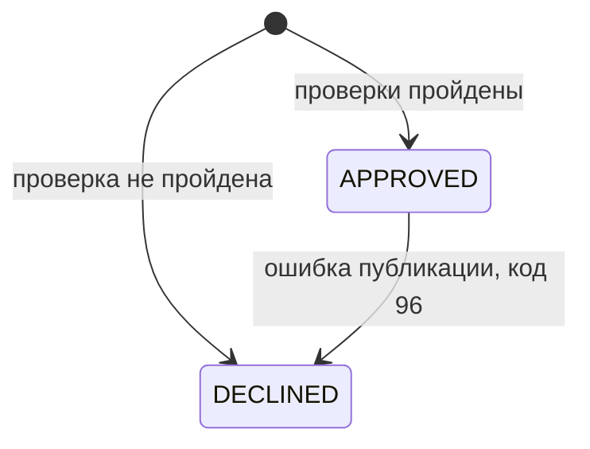
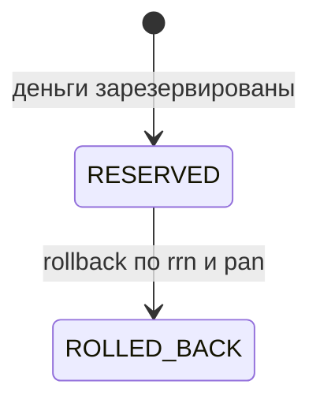

# A6. State-transition

## Что было дополнено

Диаграммы состояний в проекте не было. Я создала её по enum и бизнес-логике. `DELETED` относится к Card, а `ROLLED_BACK` - к Reservation, не к `TransactionStatus`; строгой матрицы переходов карты в коде нет.

### Состояния карты

Через PATCH и bulk-update код может присвоить и другие значения из `CardStatus`. Автоматического перехода в `EXPIRED` по `expiryDate` я не нашла.

### Результат авторизации

### Состояния резервирования

`TransactionStatus` содержит только `APPROVED` и `DECLINED`. Состояния `RESERVED` и `ROLLED_BACK` относятся к `ReservationStatus`.

## Верификация по коду

### Статусы карты

- Статусы карты посмотрела в [`CardStatus.java`](../../../services/card-management/src/main/java/com/processing/cardmanagement/models/CardStatus.java). Там есть `ACTIVE`, `INACTIVE`, `BLOCKED`, `EXPIRED` и `DELETED`.
- В задании статус `DELETED` не указан, но в коде он есть, поэтому я тоже добавила его на диаграмму.
- При создании карта получает статус `ACTIVE`. Это видно в [`CardServiceImpl.java`](../../../services/card-management/src/main/java/com/processing/cardmanagement/services/CardServiceImpl.java).
- Статус можно изменить через PATCH или bulk-update. Отдельных ограничений на переходы между статусами я не нашла.
- При удалении карты вызывается метод `deleted()` из [`Card.java`](../../../services/card-management/src/main/java/com/processing/cardmanagement/models/Card.java), и карта получает статус `DELETED`.
- Автоматического перехода в `EXPIRED` я не нашла. Срок действия просто проверяется во время авторизации.

### Статусы транзакции

- В [`TransactionStatus.java`](../../../services/common/src/main/java/com/processing/common/dto/transactionlogger/TransactionStatus.java) есть только два статуса: `APPROVED` и `DECLINED`.
- `APPROVED` означает, что транзакция одобрена, а `DECLINED` - что она отклонена.
- Статуса `ROLLED_BACK` здесь нет.

### Статусы резервирования

- `ROLLED_BACK` относится к резервированию денег, а не к самой транзакции.
- В [`ReservationStatus.java`](../../../services/card-management/src/main/java/com/processing/cardmanagement/models/ReservationStatus.java) есть два статуса: `RESERVED` и `ROLLED_BACK`.
- Сначала резервирование создаётся со статусом `RESERVED`.
- Если выполняется rollback, в [`Reservation.java`](../../../services/card-management/src/main/java/com/processing/cardmanagement/models/Reservation.java) статус меняется на `ROLLED_BACK`, а деньги возвращаются на баланс карты.

